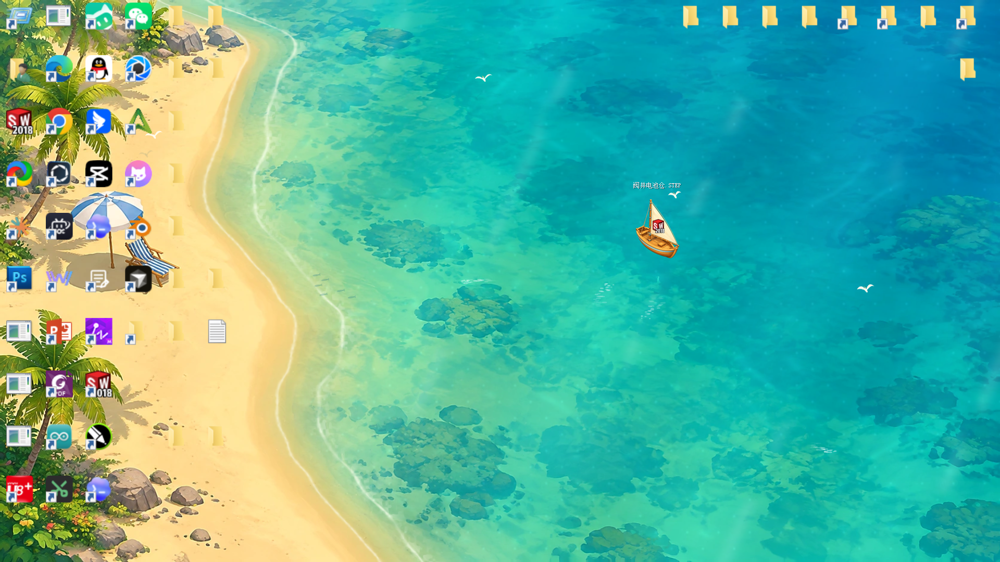

# 文件漂走了 · WhereFile

*Let your files drift.*

把桌面文件拖进海里，变成随波漂流的小船。一个轻量的 Windows 动态壁纸项目，文件与设置保存在本机。



## 功能

- 热带海湾、雪松湖岸、秋日湖畔三种正式壁纸，带动态海浪与全海域漂流。
- 真实桌面文件、文件夹、快捷方式可以变成小船；双击小船打开原文件，拖回岸边恢复图标。
- 托盘中暂停、切换风景或退出；退出后恢复桌面图标。
- 前台应用最大化或全屏覆盖主显示器、或系统锁屏时自动暂停，返回桌面后恢复，减少后台占用。
- 网页版本支持导入文件副本、搜索和预览。

桌面联动目前仅支持主显示器，需要关闭桌面的“自动排列图标”。回收站、此电脑等系统图标暂不转换。

## 运行网页

需要 Node.js 18+，无需安装 npm 依赖。

```powershell
npm start
```

打开 [http://127.0.0.1:4173](http://127.0.0.1:4173)。

## Windows 桌面版

在 [官网](https://wherefile.soul.中国/) 下载 0.1.3 Windows x64 单文件安装包，双击 EXE 安装即可。[GitHub Releases](https://github.com/fanshouheng/WhereFile/releases/latest) 目前仍提供 0.1.2 免安装包。

需要 Windows 10/11 x64、.NET Framework 4.6.2+ 和 Microsoft Edge WebView2 Runtime。也可在项目目录自行构建：

```powershell
powershell -NoProfile -ExecutionPolicy Bypass -File desktop/build.ps1
```

运行 `output/desktop/WhereFile/WhereFile.exe`，在管理窗口点击“设为桌面壁纸”。也可以双击 `启动WhereFile壁纸.cmd`，首次启动会自动构建。构建后日常使用无需 Node.js、Python 或生图 API Key。

构建单文件 EXE 安装包：

```powershell
powershell -NoProfile -ExecutionPolicy Bypass -File desktop/build-installer.ps1
```

当前输出为 `output/installer/WhereFile-v0.1.3-Setup-x64.exe`，下载这一个文件即可安装，无需解压。默认安装到 `%LOCALAPPDATA%\Programs\WhereFile`，无需管理员权限；提供开始菜单快捷方式和 Windows 卸载入口，卸载保留本机文件库与设置。缺少 WebView2 时会自动联网安装运行环境。

构建工具仅解包到忽略的 `output/build-deps/installer/`，不安装到系统；首次构建需联网。0.1.3 安装包已通过官网提供下载，尚未上传 GitHub Releases。

Windows 11 桌面层级兼容修复已收到用户实机测试通过的反馈，已包含在官网的 0.1.3 安装包中；与 GitHub 0.1.2 的验证及发布差异见 [桌面验证记录](docs/desktop-verification.md)。性能测试条件与适用范围见 [性能验证](docs/performance.md)。

## 官网与安装包下载

```powershell
npm run site
```

打开 [http://127.0.0.1:4177](http://127.0.0.1:4177)。中文官网包含文件变船互动示意、三套正式风景、六套标注“尚未上线”的主题预览、功能与常见问题，以及 0.1.3 安装包的直接下载。网站源在 `website/`，构建与预览独立于正式软件和设计预览。

先执行 `desktop/build-installer.ps1` 准备当前版本安装包，再执行 `npm run site:build`。构建输出为 `output/site`，只包含官网资源、正式素材与安装包；`download.json` 的版本来自 `package.json`，文件大小和 SHA256 来自实际安装包。`npm run site:verify` 会验证完整下载、响应头、哈希及路径隔离。

Cloudflare Pages 项目为 `wherefile`，配置在 `wrangler.jsonc`。更新时先构建安装包和官网，再执行 `npx wrangler@4.161.0 pages deploy output/site --project-name wherefile --branch master` 上传完整目录。这不是 Git 自动构建：安装包在本地生成，不在仓库中，云端只运行 `npm run site:build` 会缺少安装包而失败。也可以设置 `WHEREFILE_DOWNLOAD_URL` 为已发布的 HTTPS 下载地址后构建；外部文件的大小、哈希与可用性不会冒充已验证。

官网已于 2026-11-13 上线至 [https://wherefile.soul.中国/](https://wherefile.soul.中国/)，备用地址为 [https://wherefile-865.pages.dev/](https://wherefile-865.pages.dev/)。自定义域名的 DNS 和 HTTPS 已激活；公网桌面及手机布局、六套主题预览和真实安装包下载已验证，下载 SHA256 与本地安装包一致。详细证据见 [桌面验证记录](docs/desktop-verification.md)。

## 主界面设计预览

```powershell
npm run preview
```

打开 [http://127.0.0.1:4175/previews/interface/](http://127.0.0.1:4175/previews/interface/)。

独立预览包含 9 个场景及各自固定的物件：水景搭配专属小船，太空搭配陨石，沙漠搭配小龙卷风。可预览切换、大小和动态效果；这些设计尚未接入正式桌面软件，不会替换系统壁纸。

## 可选：生成素材

可复用的制作流程在 [wallpaper-theme 技能](skills/wallpaper-theme/SKILL.md)：从主题构图、背景与透明物件提示词，到物件处理和独立动态预览。技能内含通用工具与单独的 WhereFile 接入说明，可用于制作不同主题。

仓库已包含运行素材，无需配置 AI。需要生成新图时，双击 `配置生图.cmd` 配置 PP.dog，使用 `gpt-image-2.5`；提示词在 `prompts/`，生成脚本为 `scripts/imagegen.ps1`。密钥保存在 Git 忽略的 `.local/`，不要提交。

## 许可

项目代码与仓库内的 AI 生成素材采用 [MIT License](LICENSE)。WebView2 等第三方依赖保留各自许可。

海浪分层与桌面嵌入思路参考 [Deskland](https://github.com/BLEZZ0102/Deskland)，未引入其源码或主题素材。
