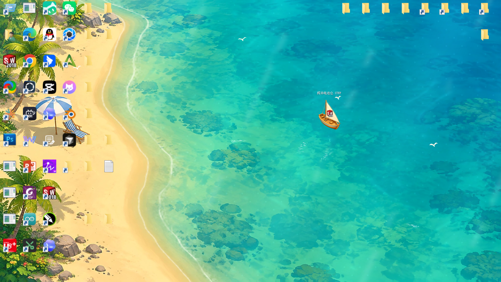

# 文件漂走了 · WhereFile

*Let your files drift.*

把桌面文件拖进海里，变成随波漂流的小船。一个轻量的 Windows 动态壁纸项目，文件与设置保存在本机。



## 功能

- 热带海湾、雪松湖岸、秋日湖畔三种正式壁纸，带动态海浪与全海域漂流。
- 真实桌面文件、文件夹、快捷方式可以变成小船；双击小船打开原文件，拖回岸边恢复图标。
- 托盘中暂停、切换风景或退出；退出后恢复桌面图标。
- 其他应用最大化、全屏或锁屏时自动暂停，返回桌面后恢复，减少后台占用。
- 网页版本支持导入文件副本、搜索和预览。

桌面联动目前仅支持主显示器，需要关闭桌面的“自动排列图标”。回收站、此电脑等系统图标暂不转换。

## 运行网页

需要 Node.js 18+，无需安装 npm 依赖。

```powershell
npm start
```

打开 [http://127.0.0.1:4173](http://127.0.0.1:4173)。

## Windows 桌面版

在 [Releases](https://github.com/fanshouheng/WhereFile/releases/latest) 下载 Windows x64 免安装包，完整解压后运行 `WhereFile.exe`。

需要 Windows 10/11 x64、.NET Framework 4.6.2+ 和 Microsoft Edge WebView2 Runtime。也可在项目目录自行构建：

```powershell
powershell -NoProfile -ExecutionPolicy Bypass -File desktop/build.ps1
```

运行 `output/desktop/WhereFile/WhereFile.exe`，在管理窗口点击“设为桌面壁纸”。也可以双击 `启动WhereFile壁纸.cmd`，首次启动会自动构建。构建后日常使用无需 Node.js、Python 或生图 API Key。

## 主界面设计预览

```powershell
npm run preview
```

打开 [http://127.0.0.1:4175/previews/interface/](http://127.0.0.1:4175/previews/interface/)。

独立预览包含 9 个场景及各自固定的物件：水景搭配专属小船，太空搭配陨石，沙漠搭配小龙卷风。可预览切换、大小和动态效果；这些设计尚未接入正式桌面软件，不会替换系统壁纸。

## 可选：生成素材

仓库已包含运行素材，无需配置 AI。需要生成新图时，双击 `配置生图.cmd` 配置 PP.dog，使用 `gpt-image-2.5`；提示词在 `prompts/`，生成脚本为 `scripts/imagegen.ps1`。密钥保存在 Git 忽略的 `.local/`，不要提交。

## 许可

项目代码与仓库内的 AI 生成素材采用 [MIT License](LICENSE)。WebView2 等第三方依赖保留各自许可。

海浪分层与桌面嵌入思路参考 [Deskland](https://github.com/BLEZZ0102/Deskland)，未引入其源码或主题素材。
